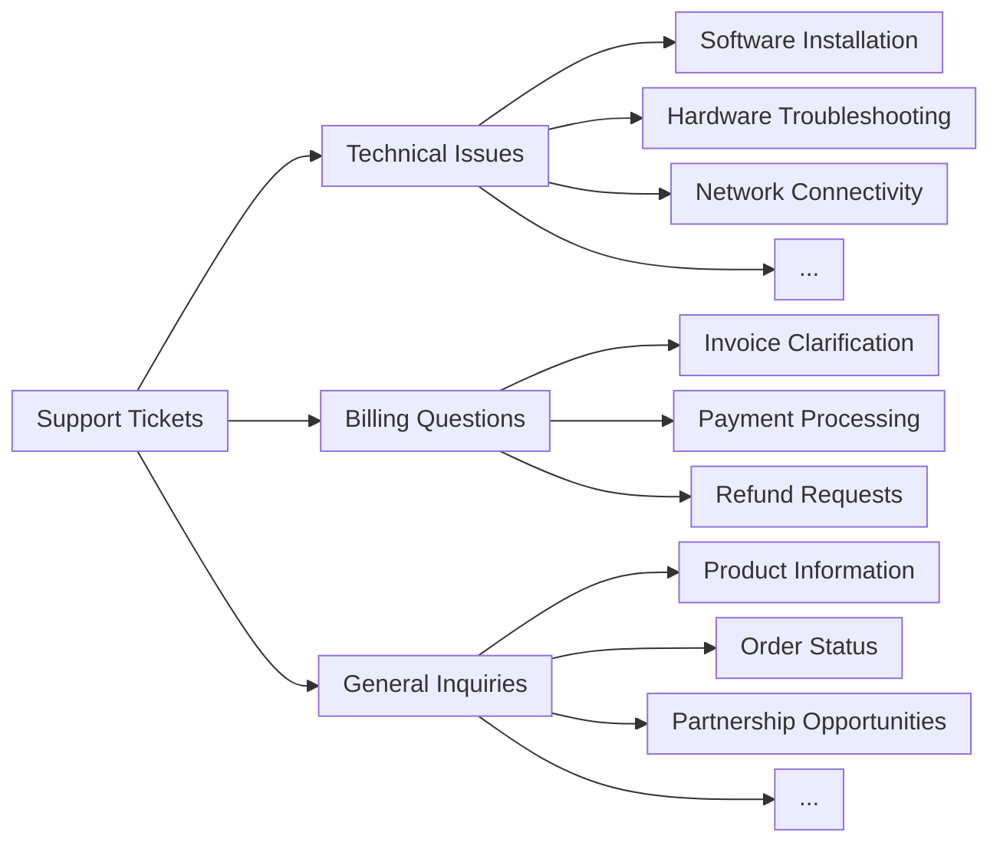

## Prerequisites

* A Claude API key and the Claude SDK installed
* Access to, and familiarity with, your existing support ticketing system
* A sample set of historical support tickets for testing

## Define whether to use Claude for ticket routing

Here are some key indicators that you should use an LLM such as Claude instead of traditional ML approaches for your classification task:

<AccordionGroup>
  <Accordion title="You have limited labeled training data available">
    Traditional ML processes require massive labeled datasets. Claude's pre-trained model can effectively classify tickets with just a few dozen labeled examples, significantly reducing data preparation time and costs.
  </Accordion>

  <Accordion title="Your classification categories are likely to change or evolve over time">
    Once a traditional ML approach has been established, changing it is a laborious and data-intensive undertaking. On the other hand, as your product or customer needs evolve, Claude can easily adapt to changes in class definitions or new classes without extensive relabeling of training data.
  </Accordion>

  <Accordion title="You need to handle complex, unstructured text inputs">
    Traditional ML models often struggle with unstructured data and require extensive feature engineering. Claude's advanced language understanding allows for accurate classification based on content and context, rather than relying on strict ontological structures.
  </Accordion>

  <Accordion title="Your classification rules are based on semantic understanding">
    Traditional ML approaches often rely on bag-of-words models or simple pattern matching. Claude excels at applying underlying rules when classes are defined by conditions rather than examples.
  </Accordion>

  <Accordion title="You need interpretable reasoning for classification decisions">
    Many traditional ML models provide little insight into their decision-making process. Claude can provide human-readable explanations for its classification decisions, building trust in the automation system and facilitating easy adaptation if needed.
  </Accordion>

  <Accordion title="You want to handle edge cases and ambiguous tickets more effectively">
    Traditional ML systems often struggle with outliers and ambiguous inputs, frequently misclassifying them or defaulting to a catch-all category. Claude's natural language processing capabilities allow it to better interpret context and nuance in support tickets, potentially reducing the number of misrouted or unclassified tickets that require manual intervention.
  </Accordion>

  <Accordion title="You need multilingual support without maintaining separate models">
    Traditional ML approaches typically require separate models or extensive translation processes for each supported language. Claude's multilingual capabilities allow it to classify tickets in various languages without the need for separate models or extensive translation processes, streamlining support for global customer bases.
  </Accordion>
</AccordionGroup>

***

## Build and deploy your LLM support workflow

### Understand your current support approach

Before you automate, it's crucial to understand your existing ticketing system. Start by investigating how your support team currently handles ticket routing.

Consider questions such as:

* What criteria are used to determine what SLA/service offering is applied?
* Is ticket routing used to determine which tier of support or product specialist a ticket goes to?
* Are there any automated rules or workflows already in place? In what cases do they fail?
* How are edge cases or ambiguous tickets handled?
* How does the team prioritize tickets?

The more you know about how humans handle certain cases, the better you can work with Claude to do the task.

### Define user intent categories

A well-defined list of user intent categories is crucial for accurate support ticket classification with Claude. Claude’s ability to route tickets effectively within your system is directly proportional to how well-defined your system’s categories are.

Here are some example user intent categories and subcategories.

<AccordionGroup>
  <Accordion title="Technical issue">
    * Hardware problem
    * Software bug
    * Compatibility issue
    * Performance problem
  </Accordion>

  <Accordion title="Account management">
    * Password reset
    * Account access issues
    * Billing inquiries
    * Subscription changes
  </Accordion>

  <Accordion title="Product information">
    * Feature inquiries
    * Product compatibility questions
    * Pricing information
    * Availability inquiries
  </Accordion>

  <Accordion title="User guidance">
    * How-to questions
    * Feature usage assistance
    * Best practices advice
    * Troubleshooting guidance
  </Accordion>

  <Accordion title="Feedback">
    * Bug reports
    * Feature requests
    * General feedback or suggestions
    * Complaints
  </Accordion>

  <Accordion title="Order-related">
    * Order status inquiries
    * Shipping information
    * Returns and exchanges
    * Order modifications
  </Accordion>

  <Accordion title="Service request">
    * Installation assistance
    * Upgrade requests
    * Maintenance scheduling
    * Service cancellation
  </Accordion>

  <Accordion title="Security concerns">
    * Data privacy inquiries
    * Suspicious activity reports
    * Security feature assistance
  </Accordion>

  <Accordion title="Compliance and legal">
    * Regulatory compliance questions
    * Terms of service inquiries
    * Legal documentation requests
  </Accordion>

  <Accordion title="Emergency support">
    * Critical system failures
    * Urgent security issues
    * Time-sensitive problems
  </Accordion>

  <Accordion title="Training and education">
    * Product training requests
    * Documentation inquiries
    * Webinar or workshop information
  </Accordion>

  <Accordion title="Integration and API">
    * Integration assistance
    * API usage questions
    * Third-party compatibility inquiries
  </Accordion>
</AccordionGroup>

In addition to intent, ticket routing and prioritization might also be influenced by other factors such as urgency, customer type, SLAs, or language. Be sure to consider other routing criteria when building your automated routing system.

### Establish success criteria

Work with your support team to [define clear success criteria](https://platform.claude.com/docs/en/test-and-evaluate/develop-tests) with measurable benchmarks, thresholds, and goals.

Here are some standard criteria and benchmarks when using LLMs for support ticket routing:

<AccordionGroup>
  <Accordion title="Classification consistency">
    This metric assesses how consistently Claude classifies similar tickets over time. It's crucial for maintaining routing reliability. Measure this by periodically testing the model with a set of standardized inputs and aiming for a consistency rate of 95 percent or higher.
  </Accordion>

  <Accordion title="Adaptation speed">
    This measures how quickly Claude can adapt to new categories or changing ticket patterns. Test this by introducing new ticket types and measuring the time it takes for the model to achieve satisfactory accuracy (for example, more than 90 percent) on these new categories. Aim for adaptation within 50–100 sample tickets.
  </Accordion>

  <Accordion title="Multilingual handling">
    This assesses Claude's ability to accurately route tickets in multiple languages. Measure the routing accuracy across different languages, aiming for no more than a 5–10 percent drop in accuracy for non-primary languages.
  </Accordion>

  <Accordion title="Edge case handling">
    This evaluates Claude's performance on unusual or complex tickets. Create a test set of edge cases and measure the routing accuracy, aiming for at least 80 percent accuracy on these challenging inputs.
  </Accordion>

  <Accordion title="Bias mitigation">
    This measures Claude's fairness in routing across different customer demographics. Regularly audit routing decisions for potential biases, aiming for consistent routing accuracy (within 2–3 percent) across all customer groups.
  </Accordion>

  <Accordion title="Prompt efficiency">
    In situations where minimizing token count is crucial, this criterion assesses how well Claude performs with minimal context. Measure routing accuracy with varying amounts of context provided, aiming for at least 90 percent accuracy with just the ticket title and a brief description.
  </Accordion>

  <Accordion title="Explainability score">
    This evaluates the quality and relevance of Claude's explanations for its routing decisions. Human raters can score explanations on a scale (for example, 1–5), with the goal of achieving an average score of 4 or higher.
  </Accordion>
</AccordionGroup>

Here are some common success criteria that might be useful regardless of whether an LLM is used:

<AccordionGroup>
  <Accordion title="Routing accuracy">
    Routing accuracy measures how often tickets are correctly assigned to the appropriate team or individual on the first try. This is typically measured as a percentage of correctly routed tickets out of total tickets. Industry benchmarks often aim for 90–95 percent accuracy, though this can vary based on the complexity of the support structure.
  </Accordion>

  <Accordion title="Time-to-assignment">
    This metric tracks how quickly tickets are assigned after being submitted. Faster assignment times generally lead to quicker resolutions and improved customer satisfaction. Best-in-class systems often achieve average assignment times of under 5 minutes, with many aiming for near-instantaneous routing (which is possible with LLM implementations).
  </Accordion>

  <Accordion title="Rerouting rate">
    The rerouting rate indicates how often tickets need to be reassigned after initial routing. A lower rate suggests more accurate initial routing. Aim for a rerouting rate below 10 percent, with top-performing systems achieving rates as low as 5 percent or less.
  </Accordion>

  <Accordion title="First-contact resolution rate">
    This measures the percentage of tickets resolved during the first interaction with the customer. Higher rates indicate efficient routing and well-prepared support teams. Industry benchmarks typically range from 70 to 75 percent, with top performers achieving rates of 80 percent or higher.
  </Accordion>

  <Accordion title="Average handling time">
    Average handling time measures how long it takes to resolve a ticket from start to finish. Efficient routing can significantly reduce this time. Benchmarks vary widely by industry and complexity, but many organizations aim to keep average handling time under 24 hours for non-critical issues.
  </Accordion>

  <Accordion title="Customer satisfaction scores">
    Often measured through post-interaction surveys, these scores reflect overall customer happiness with the support process. Effective routing contributes to higher satisfaction. Aim for CSAT scores of 90 percent or higher, with top performers often achieving satisfaction rates of at least 95 percent.
  </Accordion>

  <Accordion title="Escalation rate">
    This measures how often tickets need to be escalated to higher tiers of support. Lower escalation rates often indicate more accurate initial routing. Strive for an escalation rate below 20 percent, with best-in-class systems achieving rates of 10 percent or less.
  </Accordion>

  <Accordion title="Agent productivity">
    This metric looks at how many tickets agents can handle effectively after implementing the routing solution. Improved routing should increase productivity. Measure this by tracking tickets resolved per agent per day or hour, aiming for a 10–20 percent improvement after implementing a new routing system.
  </Accordion>

  <Accordion title="Self-service deflection rate">
    This measures the percentage of potential tickets resolved through self-service options before entering the routing system. Higher rates indicate effective pre-routing triage. Aim for a deflection rate of 20–30 percent, with top performers achieving rates of 40 percent or higher.
  </Accordion>

  <Accordion title="Cost per ticket">
    This metric calculates the average cost to resolve each support ticket. Efficient routing should help reduce this cost over time. Although benchmarks vary widely, many organizations aim to reduce cost per ticket by 10–15 percent after implementing an improved routing system.
  </Accordion>
</AccordionGroup>

### Choose the right Claude model

The choice of model depends on the trade-offs among cost, accuracy, and response time.

Claude Haiku 5.5 (`claude-haiku-5-5`) suits ticket routing: it's the fastest and most cost-effective current model, and at `low` effort it handles simple, high-volume requests such as classification. If your classification problem requires deep subject matter expertise, a large volume of intent categories, or complex reasoning, you may opt for the [larger Sonnet model](https://platform.claude.com/docs/en/models/overview).

### Build a strong prompt

Ticket routing is a type of classification task. Claude analyzes the content of a support ticket and classifies it into predefined categories based on the issue type, urgency, required expertise, or other relevant factors.

Write a ticket classification prompt. The initial prompt should contain the contents of the user request and return both the reasoning and the intent.

<Tip>
  Try the [metaprompt recipe from the Claude Cookbook](https://colab.research.google.com/github/anthropics/claude-cookbooks/blob/main/misc/metaprompt.ipynb) to have Claude write a first draft for you.
</Tip>

Here's an example ticket routing classification prompt:

<CodeGroup exclude="shell">
  <CodeGroupItem language="cURL">
    Build the prompt in code.
  </CodeGroupItem>

  <CodeGroupItem language="CLI">
    Build the prompt in code.
  </CodeGroupItem>

  ```python Python
  def classify_support_request(ticket_contents):
      # Define the prompt for the classification task
      classification_prompt = f"""You will be acting as a customer support ticket classification system. Your task is to analyze customer support requests and output the appropriate classification intent for each request, along with your reasoning.

          Here is the customer support request you need to classify:

          <request>{ticket_contents}</request>

          Please carefully analyze the above request to determine the customer's core intent and needs. Consider what the customer is asking for has concerns about.

          First, write out your reasoning and analysis of how to classify this request inside <reasoning> tags.

          Then, output the appropriate classification label for the request inside a <intent> tag. The valid intents are:
          <intents>
          <intent>Support, Feedback, Complaint</intent>
          <intent>Order Tracking</intent>
          <intent>Refund/Exchange</intent>
          </intents>

          A request may have ONLY ONE applicable intent. Only include the intent that is most applicable to the request.

          As an example, consider the following request:
          <request>Hello! I had high-speed fiber internet installed on Saturday and my installer, Kevin, was absolutely fantastic! Where can I send my positive review? Thanks for your help!</request>

          Here is an example of how your output should be formatted (for the above example request):
          <reasoning>The user seeks information in order to leave positive feedback.</reasoning>
          <intent>Support, Feedback, Complaint</intent>

          Here are a few more examples:
          <examples>
          <example 2>
          Example 2 Input:
          <request>I wanted to write and personally thank you for the compassion you showed towards my family during my father's funeral this past weekend. Your staff was so considerate and helpful throughout this whole process; it really took a load off our shoulders. The visitation brochures were beautiful. We'll never forget the kindness you showed us and we are so appreciative of how smoothly the proceedings went. Thank you, again, Amarantha Hill on behalf of the Hill Family.</request>

          Example 2 Output:
          <reasoning>User leaves a positive review of their experience.</reasoning>
          <intent>Support, Feedback, Complaint</intent>
          </example 2>
          <example 3>

          […]

          </example 8>
          <example 9>
          Example 9 Input:
          <request>Your website keeps sending ad-popups that block the entire screen. It took me twenty minutes just to finally find the phone number to call and complain. How can I possibly access my account information with all of these popups? Can you access my account for me, since your website is broken? I need to know what the address is on file.</request>

          Example 9 Output:
          <reasoning>The user requests help accessing their web account information.</reasoning>
          <intent>Support, Feedback, Complaint</intent>
          </example 9>

          Remember to always include your classification reasoning before your actual intent output. The reasoning should be enclosed in <reasoning> tags and the intent in <intent> tags. Return only the reasoning and the intent.
          """
  ```

  ```typescript TypeScript
  function classifySupportRequest(ticketContents: string) {
    // Define the prompt for the classification task
    const classificationPrompt = `You will be acting as a customer support ticket classification system. Your task is to analyze customer support requests and output the appropriate classification intent for each request, along with your reasoning.

      Here is the customer support request you need to classify:

      <request>${ticketContents}</request>

      Please carefully analyze the above request to determine the customer's core intent and needs. Consider what the customer is asking for has concerns about.

      First, write out your reasoning and analysis of how to classify this request inside <reasoning> tags.

      Then, output the appropriate classification label for the request inside a <intent> tag. The valid intents are:
      <intents>
      <intent>Support, Feedback, Complaint</intent>
      <intent>Order Tracking</intent>
      <intent>Refund/Exchange</intent>
      </intents>

      A request may have ONLY ONE applicable intent. Only include the intent that is most applicable to the request.

      As an example, consider the following request:
      <request>Hello! I had high-speed fiber internet installed on Saturday and my installer, Kevin, was absolutely fantastic! Where can I send my positive review? Thanks for your help!</request>

      Here is an example of how your output should be formatted (for the above example request):
      <reasoning>The user seeks information in order to leave positive feedback.</reasoning>
      <intent>Support, Feedback, Complaint</intent>

      Here are a few more examples:
      <examples>
      <example 2>
      Example 2 Input:
      <request>I wanted to write and personally thank you for the compassion you showed towards my family during my father's funeral this past weekend. Your staff was so considerate and helpful throughout this whole process; it really took a load off our shoulders. The visitation brochures were beautiful. We'll never forget the kindness you showed us and we are so appreciative of how smoothly the proceedings went. Thank you, again, Amarantha Hill on behalf of the Hill Family.</request>

      Example 2 Output:
      <reasoning>User leaves a positive review of their experience.</reasoning>
      <intent>Support, Feedback, Complaint</intent>
      </example 2>
      <example 3>

      […]

      </example 8>
      <example 9>
      Example 9 Input:
      <request>Your website keeps sending ad-popups that block the entire screen. It took me twenty minutes just to finally find the phone number to call and complain. How can I possibly access my account information with all of these popups? Can you access my account for me, since your website is broken? I need to know what the address is on file.</request>

      Example 9 Output:
      <reasoning>The user requests help accessing their web account information.</reasoning>
      <intent>Support, Feedback, Complaint</intent>
      </example 9>

      Remember to always include your classification reasoning before your actual intent output. The reasoning should be enclosed in <reasoning> tags and the intent in <intent> tags. Return only the reasoning and the intent.
      `;
  }
  ```

  ```csharp C#
  void ClassifySupportRequest(string ticketContents)
  {
      // Define the prompt for the classification task
      var classificationPrompt = $"""
          You will be acting as a customer support ticket classification system. Your task is to analyze customer support requests and output the appropriate classification intent for each request, along with your reasoning.

          Here is the customer support request you need to classify:

          <request>{ticketContents}</request>

          Please carefully analyze the above request to determine the customer's core intent and needs. Consider what the customer is asking for has concerns about.

          First, write out your reasoning and analysis of how to classify this request inside <reasoning> tags.

          Then, output the appropriate classification label for the request inside a <intent> tag. The valid intents are:
          <intents>
          <intent>Support, Feedback, Complaint</intent>
          <intent>Order Tracking</intent>
          <intent>Refund/Exchange</intent>
          </intents>

          A request may have ONLY ONE applicable intent. Only include the intent that is most applicable to the request.

          As an example, consider the following request:
          <request>Hello! I had high-speed fiber internet installed on Saturday and my installer, Kevin, was absolutely fantastic! Where can I send my positive review? Thanks for your help!</request>

          Here is an example of how your output should be formatted (for the above example request):
          <reasoning>The user seeks information in order to leave positive feedback.</reasoning>
          <intent>Support, Feedback, Complaint</intent>

          Here are a few more examples:
          <examples>
          <example 2>
          Example 2 Input:
          <request>I wanted to write and personally thank you for the compassion you showed towards my family during my father's funeral this past weekend. Your staff was so considerate and helpful throughout this whole process; it really took a load off our shoulders. The visitation brochures were beautiful. We'll never forget the kindness you showed us and we are so appreciative of how smoothly the proceedings went. Thank you, again, Amarantha Hill on behalf of the Hill Family.</request>

          Example 2 Output:
          <reasoning>User leaves a positive review of their experience.</reasoning>
          <intent>Support, Feedback, Complaint</intent>
          </example 2>
          <example 3>

          […]

          </example 8>
          <example 9>
          Example 9 Input:
          <request>Your website keeps sending ad-popups that block the entire screen. It took me twenty minutes just to finally find the phone number to call and complain. How can I possibly access my account information with all of these popups? Can you access my account for me, since your website is broken? I need to know what the address is on file.</request>

          Example 9 Output:
          <reasoning>The user requests help accessing their web account information.</reasoning>
          <intent>Support, Feedback, Complaint</intent>
          </example 9>

          Remember to always include your classification reasoning before your actual intent output. The reasoning should be enclosed in <reasoning> tags and the intent in <intent> tags. Return only the reasoning and the intent.
          """;
  }
  ```

  ```go Go
  func classifySupportRequest(ticketContents string) {
  	// Define the prompt for the classification task
  	classificationPrompt := `You will be acting as a customer support ticket classification system. Your task is to analyze customer support requests and output the appropriate classification intent for each request, along with your reasoning.

  		Here is the customer support request you need to classify:

  		<request>` + ticketContents + `</request>

  		Please carefully analyze the above request to determine the customer's core intent and needs. Consider what the customer is asking for has concerns about.

  		First, write out your reasoning and analysis of how to classify this request inside <reasoning> tags.

  		Then, output the appropriate classification label for the request inside a <intent> tag. The valid intents are:
  		<intents>
  		<intent>Support, Feedback, Complaint</intent>
  		<intent>Order Tracking</intent>
  		<intent>Refund/Exchange</intent>
  		</intents>

  		A request may have ONLY ONE applicable intent. Only include the intent that is most applicable to the request.

  		As an example, consider the following request:
  		<request>Hello! I had high-speed fiber internet installed on Saturday and my installer, Kevin, was absolutely fantastic! Where can I send my positive review? Thanks for your help!</request>

  		Here is an example of how your output should be formatted (for the above example request):
  		<reasoning>The user seeks information in order to leave positive feedback.</reasoning>
  		<intent>Support, Feedback, Complaint</intent>

  		Here are a few more examples:
  		<examples>
  		<example 2>
  		Example 2 Input:
  		<request>I wanted to write and personally thank you for the compassion you showed towards my family during my father's funeral this past weekend. Your staff was so considerate and helpful throughout this whole process; it really took a load off our shoulders. The visitation brochures were beautiful. We'll never forget the kindness you showed us and we are so appreciative of how smoothly the proceedings went. Thank you, again, Amarantha Hill on behalf of the Hill Family.</request>

  		Example 2 Output:
  		<reasoning>User leaves a positive review of their experience.</reasoning>
  		<intent>Support, Feedback, Complaint</intent>
  		</example 2>
  		<example 3>

  		[…]

  		</example 8>
  		<example 9>
  		Example 9 Input:
  		<request>Your website keeps sending ad-popups that block the entire screen. It took me twenty minutes just to finally find the phone number to call and complain. How can I possibly access my account information with all of these popups? Can you access my account for me, since your website is broken? I need to know what the address is on file.</request>

  		Example 9 Output:
  		<reasoning>The user requests help accessing their web account information.</reasoning>
  		<intent>Support, Feedback, Complaint</intent>
  		</example 9>

  		Remember to always include your classification reasoning before your actual intent output. The reasoning should be enclosed in <reasoning> tags and the intent in <intent> tags. Return only the reasoning and the intent.
  		`
  // ...
  }
  ```

  ```java Java
  void classifySupportRequest(String ticketContents) {
      // Define the prompt for the classification task
      String classificationPrompt = """
          You will be acting as a customer support ticket classification system. Your task is to analyze customer support requests and output the appropriate classification intent for each request, along with your reasoning.

          Here is the customer support request you need to classify:

          <request>%s</request>

          Please carefully analyze the above request to determine the customer's core intent and needs. Consider what the customer is asking for has concerns about.

          First, write out your reasoning and analysis of how to classify this request inside <reasoning> tags.

          Then, output the appropriate classification label for the request inside a <intent> tag. The valid intents are:
          <intents>
          <intent>Support, Feedback, Complaint</intent>
          <intent>Order Tracking</intent>
          <intent>Refund/Exchange</intent>
          </intents>

          A request may have ONLY ONE applicable intent. Only include the intent that is most applicable to the request.

          As an example, consider the following request:
          <request>Hello! I had high-speed fiber internet installed on Saturday and my installer, Kevin, was absolutely fantastic! Where can I send my positive review? Thanks for your help!</request>

          Here is an example of how your output should be formatted (for the above example request):
          <reasoning>The user seeks information in order to leave positive feedback.</reasoning>
          <intent>Support, Feedback, Complaint</intent>

          Here are a few more examples:
          <examples>
          <example 2>
          Example 2 Input:
          <request>I wanted to write and personally thank you for the compassion you showed towards my family during my father's funeral this past weekend. Your staff was so considerate and helpful throughout this whole process; it really took a load off our shoulders. The visitation brochures were beautiful. We'll never forget the kindness you showed us and we are so appreciative of how smoothly the proceedings went. Thank you, again, Amarantha Hill on behalf of the Hill Family.</request>

          Example 2 Output:
          <reasoning>User leaves a positive review of their experience.</reasoning>
          <intent>Support, Feedback, Complaint</intent>
          </example 2>
          <example 3>

          […]

          </example 8>
          <example 9>
          Example 9 Input:
          <request>Your website keeps sending ad-popups that block the entire screen. It took me twenty minutes just to finally find the phone number to call and complain. How can I possibly access my account information with all of these popups? Can you access my account for me, since your website is broken? I need to know what the address is on file.</request>

          Example 9 Output:
          <reasoning>The user requests help accessing their web account information.</reasoning>
          <intent>Support, Feedback, Complaint</intent>
          </example 9>

          Remember to always include your classification reasoning before your actual intent output. The reasoning should be enclosed in <reasoning> tags and the intent in <intent> tags. Return only the reasoning and the intent.
          """.formatted(ticketContents);
  }
  ```

  ```php PHP
  function classifySupportRequest(string $ticketContents): void
  {
      // Define the prompt for the classification task
      $classificationPrompt = <<<PROMPT
          You will be acting as a customer support ticket classification system. Your task is to analyze customer support requests and output the appropriate classification intent for each request, along with your reasoning.

          Here is the customer support request you need to classify:

          <request>{$ticketContents}</request>

          Please carefully analyze the above request to determine the customer's core intent and needs. Consider what the customer is asking for has concerns about.

          First, write out your reasoning and analysis of how to classify this request inside <reasoning> tags.

          Then, output the appropriate classification label for the request inside a <intent> tag. The valid intents are:
          <intents>
          <intent>Support, Feedback, Complaint</intent>
          <intent>Order Tracking</intent>
          <intent>Refund/Exchange</intent>
          </intents>

          A request may have ONLY ONE applicable intent. Only include the intent that is most applicable to the request.

          As an example, consider the following request:
          <request>Hello! I had high-speed fiber internet installed on Saturday and my installer, Kevin, was absolutely fantastic! Where can I send my positive review? Thanks for your help!</request>

          Here is an example of how your output should be formatted (for the above example request):
          <reasoning>The user seeks information in order to leave positive feedback.</reasoning>
          <intent>Support, Feedback, Complaint</intent>

          Here are a few more examples:
          <examples>
          <example 2>
          Example 2 Input:
          <request>I wanted to write and personally thank you for the compassion you showed towards my family during my father's funeral this past weekend. Your staff was so considerate and helpful throughout this whole process; it really took a load off our shoulders. The visitation brochures were beautiful. We'll never forget the kindness you showed us and we are so appreciative of how smoothly the proceedings went. Thank you, again, Amarantha Hill on behalf of the Hill Family.</request>

          Example 2 Output:
          <reasoning>User leaves a positive review of their experience.</reasoning>
          <intent>Support, Feedback, Complaint</intent>
          </example 2>
          <example 3>

          […]

          </example 8>
          <example 9>
          Example 9 Input:
          <request>Your website keeps sending ad-popups that block the entire screen. It took me twenty minutes just to finally find the phone number to call and complain. How can I possibly access my account information with all of these popups? Can you access my account for me, since your website is broken? I need to know what the address is on file.</request>

          Example 9 Output:
          <reasoning>The user requests help accessing their web account information.</reasoning>
          <intent>Support, Feedback, Complaint</intent>
          </example 9>

          Remember to always include your classification reasoning before your actual intent output. The reasoning should be enclosed in <reasoning> tags and the intent in <intent> tags. Return only the reasoning and the intent.
          PROMPT;
  }
  ```

  ```ruby Ruby
  def classify_support_request(ticket_contents)
    # Define the prompt for the classification task
    classification_prompt = <<~PROMPT
      You will be acting as a customer support ticket classification system. Your task is to analyze customer support requests and output the appropriate classification intent for each request, along with your reasoning.

      Here is the customer support request you need to classify:

      <request>#{ticket_contents}</request>

      Please carefully analyze the above request to determine the customer's core intent and needs. Consider what the customer is asking for has concerns about.

      First, write out your reasoning and analysis of how to classify this request inside <reasoning> tags.

      Then, output the appropriate classification label for the request inside a <intent> tag. The valid intents are:
      <intents>
      <intent>Support, Feedback, Complaint</intent>
      <intent>Order Tracking</intent>
      <intent>Refund/Exchange</intent>
      </intents>

      A request may have ONLY ONE applicable intent. Only include the intent that is most applicable to the request.

      As an example, consider the following request:
      <request>Hello! I had high-speed fiber internet installed on Saturday and my installer, Kevin, was absolutely fantastic! Where can I send my positive review? Thanks for your help!</request>

      Here is an example of how your output should be formatted (for the above example request):
      <reasoning>The user seeks information in order to leave positive feedback.</reasoning>
      <intent>Support, Feedback, Complaint</intent>

      Here are a few more examples:
      <examples>
      <example 2>
      Example 2 Input:
      <request>I wanted to write and personally thank you for the compassion you showed towards my family during my father's funeral this past weekend. Your staff was so considerate and helpful throughout this whole process; it really took a load off our shoulders. The visitation brochures were beautiful. We'll never forget the kindness you showed us and we are so appreciative of how smoothly the proceedings went. Thank you, again, Amarantha Hill on behalf of the Hill Family.</request>

      Example 2 Output:
      <reasoning>User leaves a positive review of their experience.</reasoning>
      <intent>Support, Feedback, Complaint</intent>
      </example 2>
      <example 3>

      […]

      </example 8>
      <example 9>
      Example 9 Input:
      <request>Your website keeps sending ad-popups that block the entire screen. It took me twenty minutes just to finally find the phone number to call and complain. How can I possibly access my account information with all of these popups? Can you access my account for me, since your website is broken? I need to know what the address is on file.</request>

      Example 9 Output:
      <reasoning>The user requests help accessing their web account information.</reasoning>
      <intent>Support, Feedback, Complaint</intent>
      </example 9>

      Remember to always include your classification reasoning before your actual intent output. The reasoning should be enclosed in <reasoning> tags and the intent in <intent> tags. Return only the reasoning and the intent.
    PROMPT
  end
  ```
</CodeGroup>

<Note>
  This prompt is written for Claude Haiku 5.5, which runs here at `low` effort. On Claude Fable 5.1, Claude Fable 5, Claude Opus 5.5, Claude Opus 5, and Claude Sonnet 5.5, ask for the intent and a one-sentence summary of the request instead. See [Keep reasoning in thinking blocks](https://platform.claude.com/docs/en/build-with-claude/refusals-and-fallback#keep-reasoning-in-thinking-blocks).
</Note>

Here are the key components of this prompt:

* The prompt template inserts `ticket_contents` (typescript, csharp, go, java: `ticketContents`; php: `$ticketContents`) into the `<request>` tags.
* The prompt gives Claude a clearly defined role as a classification system that carefully analyzes the ticket content to determine the customer's core intent and needs.
* The prompt instructs Claude on proper output formatting, in this case to provide its reasoning and analysis inside `<reasoning>` tags, followed by the appropriate classification label inside `<intent>` tags.
* The prompt specifies the valid intent categories: "Support, Feedback, Complaint", "Order Tracking", and "Refund/Exchange".
* The prompt includes a few examples (a.k.a. few-shot prompting) to illustrate how the output should be formatted, which improves accuracy and consistency.

Having Claude split its response into separate XML tag sections lets you use regular expressions to extract the reasoning and intent from the output independently. This lets you create targeted next steps in the ticket routing workflow, such as using only the intent to decide which person to route the ticket to.

### Deploy your prompt

It’s hard to know how well your prompt works without deploying it in a test production setting and [running evaluations](https://platform.claude.com/docs/en/test-and-evaluate/develop-tests).

Build the deployment structure. Start by defining the function signature for wrapping the call to Claude. Extend the function you started writing earlier, which takes `ticket_contents` (typescript, csharp, go, java: `ticketContents`; php: `$ticketContents`) as input, so that it now returns the reasoning and the intent as output. If you have an existing automation using traditional ML, you'll want to follow that signature instead.

<CodeGroup exclude="shell">
  <CodeGroupItem language="cURL">
    This workflow needs more logic than a single shell command. Use the Claude SDK to run it.
  </CodeGroupItem>

  <CodeGroupItem language="CLI">
    This workflow needs more logic than a single shell command. Use the Claude SDK to run it.
  </CodeGroupItem>

  ```python Python
  import re

  # Create an instance of the Claude API client
  client = anthropic.Anthropic()

  # Set the default model
  DEFAULT_MODEL = "claude-haiku-5-5"


  def classify_support_request(ticket_contents):
      # Define the prompt for the classification task
      classification_prompt = f"""You will be acting as a customer support ticket classification system.
          […]
          ... The reasoning should be enclosed in <reasoning> tags and the intent in <intent> tags. Return only the reasoning and the intent.
          """
      # Send the prompt to the API to classify the support request.
      message = client.messages.create(
          model=DEFAULT_MODEL,
          max_tokens=2048,
          output_config={"effort": "low"},
          messages=[{"role": "user", "content": classification_prompt}],
          stream=False,
      )
      reasoning_and_intent = next(
          (block.text for block in message.content if block.type == "text"), ""
      )

      # Use Python's regular expressions library to extract `reasoning`.
      reasoning_match = re.search(
          r"<reasoning>(.*?)</reasoning>", reasoning_and_intent, re.DOTALL
      )
      reasoning = reasoning_match.group(1).strip() if reasoning_match else ""

      # Similarly, also extract the `intent`.
      intent_match = re.search(r"<intent>(.*?)</intent>", reasoning_and_intent, re.DOTALL)
      intent = intent_match.group(1).strip() if intent_match else ""

      return reasoning, intent
  ```

  ```typescript TypeScript
  // Create an instance of the Claude API client
  const client = new Anthropic();

  // Set the default model
  const DEFAULT_MODEL = "claude-haiku-5-5";

  async function classifySupportRequest(
    ticketContents: string
  ): Promise<{ reasoning: string; intent: string }> {
    // Define the prompt for the classification task
    const classificationPrompt = `You will be acting as a customer support ticket classification system.
      […]
      ... The reasoning should be enclosed in <reasoning> tags and the intent in <intent> tags. Return only the reasoning and the intent.
      `;
    // Send the prompt to the API to classify the support request.
    const message = await client.messages.create({
      model: DEFAULT_MODEL,
      max_tokens: 2048,
      output_config: { effort: "low" },
      messages: [{ role: "user", content: classificationPrompt }]
    });
    const textBlock = message.content.find((block) => block.type === "text");
    const reasoningAndIntent = textBlock?.text ?? "";

    // Use a regular expression to extract `reasoning`.
    const reasoningMatch = /<reasoning>(.*?)<\/reasoning>/s.exec(reasoningAndIntent);
    const reasoning = reasoningMatch?.[1].trim() ?? "";

    // Similarly, also extract the `intent`.
    const intentMatch = /<intent>(.*?)<\/intent>/s.exec(reasoningAndIntent);
    const intent = intentMatch?.[1].trim() ?? "";

    return { reasoning, intent };
  }
  ```

  ```csharp C#
  using System.Text.RegularExpressions;
  // ...

  // Create an instance of the Claude API client
  AnthropicClient client = new();

  // Set the default model
  const Model DefaultModel = Model.ClaudeHaiku5_5;

  async Task<(string Reasoning, string Intent)> ClassifySupportRequest(string ticketContents)
  {
      // Define the prompt for the classification task
      var classificationPrompt = """
          You will be acting as a customer support ticket classification system.
          […]
          ... The reasoning should be enclosed in <reasoning> tags and the intent in <intent> tags. Return only the reasoning and the intent.
          """;
      // Send the prompt to the API to classify the support request.
      var message = await client.Messages.Create(new MessageCreateParams
      {
          Model = DefaultModel,
          MaxTokens = 2048,
          OutputConfig = new OutputConfig { Effort = Effort.Low },
          Messages = [new UserMessageParam { Content = classificationPrompt }],
      });
      var reasoningAndIntent = "";
      foreach (var block in message.Content)
      {
          if (block.TryPickText(out var textBlock))
          {
              reasoningAndIntent = textBlock.Text;
              break;
          }
      }

      // Use a regular expression to extract `reasoning`.
      var reasoningMatch = Regex.Match(reasoningAndIntent, "<reasoning>(.*?)</reasoning>", RegexOptions.Singleline);
      var reasoning = reasoningMatch.Success ? reasoningMatch.Groups[1].Value.Trim() : "";

      // Similarly, also extract the `intent`.
      var intentMatch = Regex.Match(reasoningAndIntent, "<intent>(.*?)</intent>", RegexOptions.Singleline);
      var intent = intentMatch.Success ? intentMatch.Groups[1].Value.Trim() : "";

      return (reasoning, intent);
  }
  ```

  ```go Go
  import (
  	"context"
  	"regexp"
  	"strings"
  // ...
  )

  // Create an instance of the Claude API client
  var client = anthropic.NewClient()

  // Set the default model
  const defaultModel = anthropic.ModelClaudeHaiku5_5

  func classifySupportRequest(ctx context.Context, ticketContents string) (reasoning, intent string, err error) {
  	// Define the prompt for the classification task
  	classificationPrompt := `You will be acting as a customer support ticket classification system.
  		[…]
  		... The reasoning should be enclosed in <reasoning> tags and the intent in <intent> tags. Return only the reasoning and the intent.
  		`
  	// Send the prompt to the API to classify the support request.
  	message, err := client.Messages.New(ctx, anthropic.MessageNewParams{
  		Model:        defaultModel,
  		MaxTokens:    2048,
  		OutputConfig: anthropic.OutputConfigParam{Effort: anthropic.OutputConfigEffortLow},
  		Messages: []anthropic.MessageParam{
  			anthropic.NewUserMessage(anthropic.NewTextBlock(classificationPrompt)),
  		},
  	})
  	if err != nil {
  		return "", "", err
  	}
  	var reasoningAndIntent string
  	for _, block := range message.Content {
  		if textBlock, ok := block.AsAny().(anthropic.TextBlock); ok {
  			reasoningAndIntent = textBlock.Text
  			break
  		}
  	}

  	// Use a regular expression to extract `reasoning`.
  	reasoningMatch := regexp.MustCompile(`(?s)<reasoning>(.*?)</reasoning>`).FindStringSubmatch(reasoningAndIntent)
  	if reasoningMatch != nil {
  		reasoning = strings.TrimSpace(reasoningMatch[1])
  	}

  	// Similarly, also extract the `intent`.
  	intentMatch := regexp.MustCompile(`(?s)<intent>(.*?)</intent>`).FindStringSubmatch(reasoningAndIntent)
  	if intentMatch != nil {
  		intent = strings.TrimSpace(intentMatch[1])
  	}

  	return reasoning, intent, nil
  }
  ```

  ```java Java
  import java.util.regex.Matcher;
  import java.util.regex.Pattern;

  // Create an instance of the Claude API client
  final AnthropicClient client = AnthropicOkHttpClient.fromEnv();

  // Set the default model
  static final Model DEFAULT_MODEL = Model.CLAUDE_HAIKU_5_5;

  record Classification(String reasoning, String intent) {}

  Classification classifySupportRequest(String ticketContents) {
      // Define the prompt for the classification task
      String classificationPrompt = """
          You will be acting as a customer support ticket classification system.
          […]
          ... The reasoning should be enclosed in <reasoning> tags and the intent in <intent> tags. Return only the reasoning and the intent.
          """;
      // Send the prompt to the API to classify the support request.
      Message message = client.messages().create(MessageCreateParams.builder()
          .model(DEFAULT_MODEL)
          .maxTokens(2048L)
          .outputConfig(OutputConfig.builder()
              .effort(OutputConfig.Effort.LOW)
              .build())
          .addUserMessage(classificationPrompt)
          .build());
      String reasoningAndIntent = message.content().stream()
          .flatMap(block -> block.text().stream())
          .map(textBlock -> textBlock.text())
          .findFirst()
          .orElse("");

      // Use a regular expression to extract `reasoning`.
      Matcher reasoningMatch = Pattern.compile("<reasoning>(.*?)</reasoning>", Pattern.DOTALL)
          .matcher(reasoningAndIntent);
      String reasoning = reasoningMatch.find() ? reasoningMatch.group(1).strip() : "";

      // Similarly, also extract the `intent`.
      Matcher intentMatch = Pattern.compile("<intent>(.*?)</intent>", Pattern.DOTALL)
          .matcher(reasoningAndIntent);
      String intent = intentMatch.find() ? intentMatch.group(1).strip() : "";

      return new Classification(reasoning, intent);
  }
  ```

  ```php PHP
  // Create an instance of the Claude API client
  $client = new Client();

  // Set the default model
  const DEFAULT_MODEL = Model::CLAUDE_HAIKU_5_5;

  /**
   * @return array{string, string} the reasoning and the intent
   */
  function classifySupportRequest(Client $client, string $ticketContents): array
  {
      // Define the prompt for the classification task
      $classificationPrompt = <<<PROMPT
          You will be acting as a customer support ticket classification system.
          […]
          ... The reasoning should be enclosed in <reasoning> tags and the intent in <intent> tags. Return only the reasoning and the intent.
          PROMPT;
      // Send the prompt to the API to classify the support request.
      $message = $client->messages->create(
          model: DEFAULT_MODEL,
          maxTokens: 2048,
          outputConfig: ['effort' => 'low'],
          messages: [['role' => 'user', 'content' => $classificationPrompt]],
      );
      $reasoningAndIntent = '';
      foreach ($message->content as $block) {
          if ($block instanceof \Anthropic\Messages\TextBlock) {
              $reasoningAndIntent = $block->text;
              break;
          }
      }

      // Use a regular expression to extract `reasoning`.
      $reasoning = preg_match('/<reasoning>(.*?)<\/reasoning>/s', $reasoningAndIntent, $reasoningMatch)
          ? trim($reasoningMatch[1])
          : '';

      // Similarly, also extract the `intent`.
      $intent = preg_match('/<intent>(.*?)<\/intent>/s', $reasoningAndIntent, $intentMatch)
          ? trim($intentMatch[1])
          : '';

      return [$reasoning, $intent];
  }
  ```

  ```ruby Ruby
  # Create an instance of the Claude API client
  client = Anthropic::Client.new

  # Set the default model
  DEFAULT_MODEL = Anthropic::Model::CLAUDE_HAIKU_5_5

  def classify_support_request(client, ticket_contents)
    # Define the prompt for the classification task
    classification_prompt = <<~PROMPT
      You will be acting as a customer support ticket classification system.
      […]
      ... The reasoning should be enclosed in <reasoning> tags and the intent in <intent> tags. Return only the reasoning and the intent.
    PROMPT
    # Send the prompt to the API to classify the support request.
    message = client.messages.create(
      model: DEFAULT_MODEL,
      max_tokens: 2048,
      output_config: { effort: "low" },
      messages: [{ role: "user", content: classification_prompt }]
    )
    reasoning_and_intent = message.content.grep(Anthropic::Models::TextBlock).first&.text || ""

    # Use a regular expression to extract `reasoning`.
    reasoning = reasoning_and_intent[%r{<reasoning>(.*?)</reasoning>}m, 1]&.strip || ""

    # Similarly, also extract the `intent`.
    intent = reasoning_and_intent[%r{<intent>(.*?)</intent>}m, 1]&.strip || ""

    [reasoning, intent]
  end
  ```
</CodeGroup>

This code:

* Creates a client instance using your API key.
* Defines a `classify_support_request()` (typescript, go, java, php: `classifySupportRequest()`; csharp: `ClassifySupportRequest()`) function that takes a `ticket_contents` (typescript, csharp, go, java: `ticketContents`; php: `$ticketContents`) string.
* Sends the `ticket_contents` (typescript, csharp, go, java: `ticketContents`; php: `$ticketContents`) to Claude for classification using the `classification_prompt` (typescript, csharp, go, java: `classificationPrompt`; php: `$classificationPrompt`).
* Returns the model's reasoning and intent extracted from the response.

Because the entire reasoning and intent text must be generated before parsing, the example does not stream the response.

***

## Evaluate your prompt

Prompting often requires testing and optimization for it to be production ready. To determine the readiness of your solution, evaluate performance based on the success criteria and thresholds you established earlier.

To run your evaluation, you need test cases to run it on. The rest of this guide assumes you have already [developed your test cases](https://platform.claude.com/docs/en/test-and-evaluate/develop-tests).

### Build an evaluation function

The example evaluation for this guide measures Claude’s performance along two key metrics:

* Accuracy
* Cost per classification

You might need to assess Claude on other axes depending on which factors are important to you.

To assess this, first modify the script so that it compares the predicted intent with the actual intent. Then have it return the API call's token usage, from which you can calculate cost.

<CodeGroup exclude="shell">
  <CodeGroupItem language="cURL">
    This workflow needs more logic than a single shell command. Use the Claude SDK to run it.
  </CodeGroupItem>

  <CodeGroupItem language="CLI">
    This workflow needs more logic than a single shell command. Use the Claude SDK to run it.
  </CodeGroupItem>

  ```python Python
  import re

  # Create an instance of the Claude API client
  client = anthropic.Anthropic()

  # Set the default model
  DEFAULT_MODEL = "claude-haiku-5-5"


  def classify_support_request(ticket_contents, actual_intent):
      # Define the prompt for the classification task
      classification_prompt = f"""You will be acting as a customer support ticket classification system.
          […]
          ...The reasoning should be enclosed in <reasoning> tags and the intent in <intent> tags. Return only the reasoning and the intent.
          """

      message = client.messages.create(
          model=DEFAULT_MODEL,
          max_tokens=2048,
          output_config={"effort": "low"},
          messages=[{"role": "user", "content": classification_prompt}],
      )
      usage = message.usage  # Get the usage statistics for the API call for how many input and output tokens were used.
      reasoning_and_intent = next(
          (block.text for block in message.content if block.type == "text"), ""
      )

      # Use Python's regular expressions library to extract `reasoning`.
      reasoning_match = re.search(
          r"<reasoning>(.*?)</reasoning>", reasoning_and_intent, re.DOTALL
      )
      reasoning = reasoning_match.group(1).strip() if reasoning_match else ""

      # Similarly, also extract the `intent`.
      intent_match = re.search(r"<intent>(.*?)</intent>", reasoning_and_intent, re.DOTALL)
      intent = intent_match.group(1).strip() if intent_match else ""

      # Check if the model's prediction is correct.
      correct = actual_intent.strip() == intent.strip()

      # Return the reasoning, intent, correct, and usage.
      return reasoning, intent, correct, usage
  ```

  ```typescript TypeScript
  // Create an instance of the Claude API client
  const client = new Anthropic();

  // Set the default model
  const DEFAULT_MODEL = "claude-haiku-5-5";

  async function classifySupportRequest(
    ticketContents: string,
    actualIntent: string
  ): Promise<{ reasoning: string; intent: string; correct: boolean; usage: Anthropic.Usage }> {
    // Define the prompt for the classification task
    const classificationPrompt = `You will be acting as a customer support ticket classification system.
      […]
      ...The reasoning should be enclosed in <reasoning> tags and the intent in <intent> tags. Return only the reasoning and the intent.
      `;

    const message = await client.messages.create({
      model: DEFAULT_MODEL,
      max_tokens: 2048,
      output_config: { effort: "low" },
      messages: [{ role: "user", content: classificationPrompt }]
    });
    // Get the usage statistics for the API call for how many input and output tokens were used.
    const usage = message.usage;
    const textBlock = message.content.find((block) => block.type === "text");
    const reasoningAndIntent = textBlock?.text ?? "";

    // Use a regular expression to extract `reasoning`.
    const reasoningMatch = /<reasoning>(.*?)<\/reasoning>/s.exec(reasoningAndIntent);
    const reasoning = reasoningMatch?.[1].trim() ?? "";

    // Similarly, also extract the `intent`.
    const intentMatch = /<intent>(.*?)<\/intent>/s.exec(reasoningAndIntent);
    const intent = intentMatch?.[1].trim() ?? "";

    // Check if the model's prediction is correct.
    const correct = actualIntent.trim() === intent.trim();

    // Return the reasoning, intent, correct, and usage.
    return { reasoning, intent, correct, usage };
  }
  ```

  ```csharp C#
  using System.Text.RegularExpressions;
  // ...

  // Create an instance of the Claude API client
  AnthropicClient client = new();

  // Set the default model
  const Model DefaultModel = Model.ClaudeHaiku5_5;

  async Task<(string Reasoning, string Intent, bool Correct, Usage Usage)> ClassifySupportRequest(string ticketContents, string actualIntent)
  {
      // Define the prompt for the classification task
      var classificationPrompt = """
          You will be acting as a customer support ticket classification system.
          […]
          ...The reasoning should be enclosed in <reasoning> tags and the intent in <intent> tags. Return only the reasoning and the intent.
          """;

      var message = await client.Messages.Create(new MessageCreateParams
      {
          Model = DefaultModel,
          MaxTokens = 2048,
          OutputConfig = new OutputConfig { Effort = Effort.Low },
          Messages = [new UserMessageParam { Content = classificationPrompt }],
      });
      // Get the usage statistics for the API call for how many input and output tokens were used.
      var usage = message.Usage;
      var reasoningAndIntent = "";
      foreach (var block in message.Content)
      {
          if (block.TryPickText(out var textBlock))
          {
              reasoningAndIntent = textBlock.Text;
              break;
          }
      }

      // Use a regular expression to extract `reasoning`.
      var reasoningMatch = Regex.Match(reasoningAndIntent, "<reasoning>(.*?)</reasoning>", RegexOptions.Singleline);
      var reasoning = reasoningMatch.Success ? reasoningMatch.Groups[1].Value.Trim() : "";

      // Similarly, also extract the `intent`.
      var intentMatch = Regex.Match(reasoningAndIntent, "<intent>(.*?)</intent>", RegexOptions.Singleline);
      var intent = intentMatch.Success ? intentMatch.Groups[1].Value.Trim() : "";

      // Check if the model's prediction is correct.
      var correct = actualIntent.Trim() == intent.Trim();

      // Return the reasoning, intent, correct, and usage.
      return (reasoning, intent, correct, usage);
  }
  ```

  ```go Go
  import (
  	"context"
  	"regexp"
  	"strings"
  // ...
  )

  // Create an instance of the Claude API client
  var client = anthropic.NewClient()

  // Set the default model
  const defaultModel = anthropic.ModelClaudeHaiku5_5

  func classifySupportRequest(ctx context.Context, ticketContents, actualIntent string) (reasoning, intent string, correct bool, usage anthropic.Usage, err error) {
  	// Define the prompt for the classification task
  	classificationPrompt := `You will be acting as a customer support ticket classification system.
  		[…]
  		...The reasoning should be enclosed in <reasoning> tags and the intent in <intent> tags. Return only the reasoning and the intent.
  		`
  	message, err := client.Messages.New(ctx, anthropic.MessageNewParams{
  		Model:        defaultModel,
  		MaxTokens:    2048,
  		OutputConfig: anthropic.OutputConfigParam{Effort: anthropic.OutputConfigEffortLow},
  		Messages: []anthropic.MessageParam{
  			anthropic.NewUserMessage(anthropic.NewTextBlock(classificationPrompt)),
  		},
  	})
  	if err != nil {
  		return "", "", false, anthropic.Usage{}, err
  	}
  	// Get the usage statistics for the API call for how many input and output tokens were used.
  	usage = message.Usage
  	var reasoningAndIntent string
  	for _, block := range message.Content {
  		if textBlock, ok := block.AsAny().(anthropic.TextBlock); ok {
  			reasoningAndIntent = textBlock.Text
  			break
  		}
  	}

  	// Use a regular expression to extract `reasoning`.
  	reasoningMatch := regexp.MustCompile(`(?s)<reasoning>(.*?)</reasoning>`).FindStringSubmatch(reasoningAndIntent)
  	if reasoningMatch != nil {
  		reasoning = strings.TrimSpace(reasoningMatch[1])
  	}

  	// Similarly, also extract the `intent`.
  	intentMatch := regexp.MustCompile(`(?s)<intent>(.*?)</intent>`).FindStringSubmatch(reasoningAndIntent)
  	if intentMatch != nil {
  		intent = strings.TrimSpace(intentMatch[1])
  	}

  	// Check if the model's prediction is correct.
  	correct = strings.TrimSpace(actualIntent) == strings.TrimSpace(intent)

  	// Return the reasoning, intent, correct, and usage.
  	return reasoning, intent, correct, usage, nil
  }
  ```

  ```java Java
  import java.util.regex.Matcher;
  import java.util.regex.Pattern;

  // Create an instance of the Claude API client
  final AnthropicClient client = AnthropicOkHttpClient.fromEnv();

  // Set the default model
  static final Model DEFAULT_MODEL = Model.CLAUDE_HAIKU_5_5;

  record Classification(String reasoning, String intent, boolean correct, Usage usage) {}

  Classification classifySupportRequest(String ticketContents, String actualIntent) {
      // Define the prompt for the classification task
      String classificationPrompt = """
          You will be acting as a customer support ticket classification system.
          […]
          ...The reasoning should be enclosed in <reasoning> tags and the intent in <intent> tags. Return only the reasoning and the intent.
          """;

      Message message = client.messages().create(MessageCreateParams.builder()
          .model(DEFAULT_MODEL)
          .maxTokens(2048L)
          .outputConfig(OutputConfig.builder()
              .effort(OutputConfig.Effort.LOW)
              .build())
          .addUserMessage(classificationPrompt)
          .build());
      // Get the usage statistics for the API call for how many input and output tokens were used.
      Usage usage = message.usage();
      String reasoningAndIntent = message.content().stream()
          .flatMap(block -> block.text().stream())
          .map(textBlock -> textBlock.text())
          .findFirst()
          .orElse("");

      // Use a regular expression to extract `reasoning`.
      Matcher reasoningMatch = Pattern.compile("<reasoning>(.*?)</reasoning>", Pattern.DOTALL)
          .matcher(reasoningAndIntent);
      String reasoning = reasoningMatch.find() ? reasoningMatch.group(1).strip() : "";

      // Similarly, also extract the `intent`.
      Matcher intentMatch = Pattern.compile("<intent>(.*?)</intent>", Pattern.DOTALL)
          .matcher(reasoningAndIntent);
      String intent = intentMatch.find() ? intentMatch.group(1).strip() : "";

      // Check if the model's prediction is correct.
      boolean correct = actualIntent.strip().equals(intent.strip());

      // Return the reasoning, intent, correct, and usage.
      return new Classification(reasoning, intent, correct, usage);
  }
  ```

  ```php PHP
  // Create an instance of the Claude API client
  $client = new Client();

  // Set the default model
  const DEFAULT_MODEL = Model::CLAUDE_HAIKU_5_5;

  /**
   * @return array{string, string, bool, Usage} the reasoning, the intent, whether the intent is correct, and the usage
   */
  function classifySupportRequest(Client $client, string $ticketContents, string $actualIntent): array
  {
      // Define the prompt for the classification task
      $classificationPrompt = <<<PROMPT
          You will be acting as a customer support ticket classification system.
          […]
          ...The reasoning should be enclosed in <reasoning> tags and the intent in <intent> tags. Return only the reasoning and the intent.
          PROMPT;

      $message = $client->messages->create(
          model: DEFAULT_MODEL,
          maxTokens: 2048,
          outputConfig: ['effort' => 'low'],
          messages: [['role' => 'user', 'content' => $classificationPrompt]],
      );
      // Get the usage statistics for the API call for how many input and output tokens were used.
      $usage = $message->usage;
      $reasoningAndIntent = '';
      foreach ($message->content as $block) {
          if ($block instanceof \Anthropic\Messages\TextBlock) {
              $reasoningAndIntent = $block->text;
              break;
          }
      }

      // Use a regular expression to extract `reasoning`.
      $reasoning = preg_match('/<reasoning>(.*?)<\/reasoning>/s', $reasoningAndIntent, $reasoningMatch)
          ? trim($reasoningMatch[1])
          : '';

      // Similarly, also extract the `intent`.
      $intent = preg_match('/<intent>(.*?)<\/intent>/s', $reasoningAndIntent, $intentMatch)
          ? trim($intentMatch[1])
          : '';

      // Check if the model's prediction is correct.
      $correct = trim($actualIntent) === trim($intent);

      // Return the reasoning, intent, correct, and usage.
      return [$reasoning, $intent, $correct, $usage];
  }
  ```

  ```ruby Ruby
  # Create an instance of the Claude API client
  client = Anthropic::Client.new

  # Set the default model
  DEFAULT_MODEL = Anthropic::Model::CLAUDE_HAIKU_5_5

  def classify_support_request(client, ticket_contents, actual_intent)
    # Define the prompt for the classification task
    classification_prompt = <<~PROMPT
      You will be acting as a customer support ticket classification system.
      […]
      ...The reasoning should be enclosed in <reasoning> tags and the intent in <intent> tags. Return only the reasoning and the intent.
    PROMPT

    message = client.messages.create(
      model: DEFAULT_MODEL,
      max_tokens: 2048,
      output_config: { effort: "low" },
      messages: [{ role: "user", content: classification_prompt }]
    )
    # Get the usage statistics for the API call for how many input and output tokens were used.
    usage = message.usage
    reasoning_and_intent = message.content.grep(Anthropic::Models::TextBlock).first&.text || ""

    # Use a regular expression to extract `reasoning`.
    reasoning = reasoning_and_intent[%r{<reasoning>(.*?)</reasoning>}m, 1]&.strip || ""

    # Similarly, also extract the `intent`.
    intent = reasoning_and_intent[%r{<intent>(.*?)</intent>}m, 1]&.strip || ""

    # Check if the model's prediction is correct.
    correct = actual_intent.strip == intent.strip

    # Return the reasoning, intent, correct, and usage.
    [reasoning, intent, correct, usage]
  end
  ```
</CodeGroup>

Here is a breakdown of the edits:

* The `classify_support_request()` (typescript, go, java, php: `classifySupportRequest()`; csharp: `ClassifySupportRequest()`) function now takes the `actual_intent` (typescript, csharp, go, java: `actualIntent`; php: `$actualIntent`) from the test cases and compares it against Claude’s intent classification to assess whether they match.
* The function extracts usage statistics for the API call to calculate cost based on input and output tokens used.

### Run your evaluation

A proper evaluation requires clear thresholds and benchmarks to determine what is a good result. The preceding script returns the values you need to measure accuracy and cost per classification, but you still need clearly established thresholds. For example:

* **Accuracy:** 95% (out of 100 tests)
* **Cost per classification:** 50% reduction on average (across 100 tests) from current routing method

Having these thresholds allows you to tell at scale, and with impartial empiricism, what method is best for you and what changes you might need to make to better fit your requirements.

***

## Improve performance

In complex scenarios, it might be helpful to consider additional strategies to improve performance beyond standard [prompt engineering techniques](https://platform.claude.com/docs/en/build-with-claude/prompt-engineering/overview) and [guardrail implementation strategies](https://platform.claude.com/docs/en/test-and-evaluate/strengthen-guardrails/reduce-hallucinations). Here are some common scenarios:

### Use a taxonomic hierarchy for cases with 20+ intent categories

As the number of classes grows, the number of examples required also expands, potentially making the prompt unwieldy. As an alternative, you can consider implementing a hierarchical classification system using a mixture of classifiers.

1. Organize your intents in a taxonomic tree structure.
2. Create a series of classifiers at every level of the tree to make a cascading routing approach possible.

For example, you might have a top-level classifier that broadly categorizes tickets into "Technical Issues," "Billing Questions," and "General Inquiries." Each of these categories can then have its own sub-classifier to further refine the classification.



* **Pros - greater nuance and accuracy:** You can create different prompts for each parent path, allowing for more targeted and context-specific classification. This can lead to improved accuracy and more nuanced handling of customer requests.

* **Cons - increased latency:** Multiple classifiers can lead to increased latency, and Anthropic recommends implementing this approach with the fastest model, Haiku.

### Use vector databases and similarity search retrieval to handle highly variable tickets

Despite providing examples being the most effective way to improve performance, if support requests are highly variable, it can be hard to include enough examples in a single prompt.

In this scenario, you could employ a vector database to do similarity searches from a dataset of examples and retrieve the most relevant examples for a given query.

This approach, outlined in detail in the [classification recipe](https://platform.claude.com/cookbook/capabilities-classification-guide), has been shown to improve performance from 71 percent accuracy to 93 percent accuracy.

### Account specifically for expected edge cases

Here are some scenarios where Claude might misclassify tickets (there might be others that are unique to your situation). In these scenarios, consider providing explicit instructions or examples in the prompt of how Claude should handle the edge case:

<AccordionGroup>
  <Accordion title="Customers make implicit requests">
    Customers often express needs indirectly. For example, "I've been waiting for my package for over two weeks now" might be an indirect request for order status.

    * **Solution:** Provide Claude with some real customer examples of these kinds of requests, along with what the underlying intent is. You can get even better results if you include a classification rationale for particularly nuanced ticket intents, so that Claude can better generalize the logic to other tickets.
  </Accordion>

  <Accordion title="Claude prioritizes emotion over intent">
    When customers express dissatisfaction, Claude might prioritize addressing the emotion over solving the underlying problem.

    * **Solution:** Provide Claude with directions on when to prioritize customer sentiment or not. For example: “Ignore all customer emotions. Focus only on analyzing the intent of the customer’s request and what information the customer might be asking for.”
  </Accordion>

  <Accordion title="Multiple issues cause issue prioritization confusion">
    When customers present multiple issues in a single interaction, Claude might have difficulty identifying the primary concern.

    * **Solution:** Clarify the prioritization of intents so that Claude can better rank the extracted intents and identify the primary concern.
  </Accordion>
</AccordionGroup>

***

## Integrate Claude into your greater support workflow

Proper integration requires that you make some decisions regarding how your Claude-based ticket routing script fits into the architecture of your greater ticket routing system. There are two ways you could do this:

* **Push-based:** The support ticket system you’re using (for example, Zendesk) triggers your code by sending a webhook event to your routing service, which then classifies the intent and routes it.
  * This approach is more web-scalable, but needs you to expose a public endpoint.
* **Pull-based:** Your code pulls for the latest tickets based on a given schedule and routes them at pull time.
  * This approach is easier to implement but might make unnecessary calls to the support ticket system when the pull frequency is too high or might be overly slow when the pull frequency is too low.

For either of these approaches, you need to wrap your script in a service. The choice of approach depends on what APIs your support ticketing system provides.

***

<CardGroup cols={2}>
  <Card title="Classification recipe" icon="link" href="https://platform.claude.com/cookbook/capabilities-classification-guide">
    Visit the classification recipe for more example code and detailed eval guidance.
  </Card>

  <Card title="Claude Console" icon="link" href="https://platform.claude.com/dashboard">
    Start building and evaluating your workflow on the Claude Console.
  </Card>
</CardGroup>
