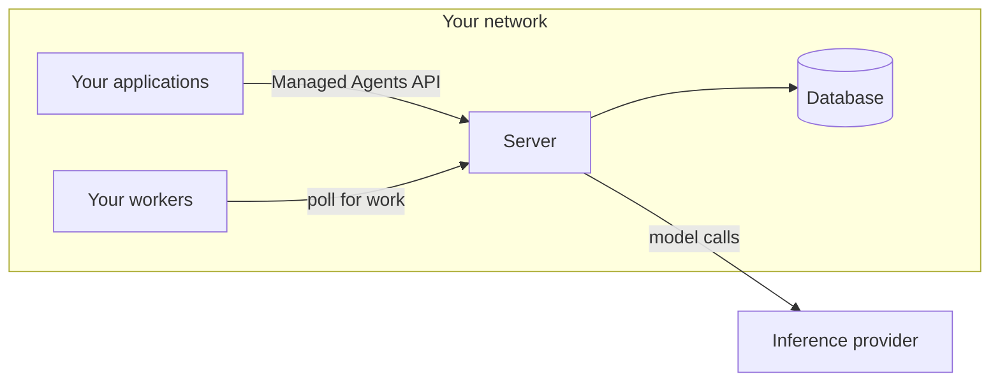

<Note>
  To request access to self-hosted Claude Managed Agents, contact your Anthropic account team.
</Note>

Self-hosted Claude Managed Agents is Managed Agents on your own infrastructure, which can be a cloud account or an on-premise data center. You host the service and the sandboxes. The model runs at Anthropic or at a provider that you choose.

Managed Agents has two parts that you can host:

* **Sandboxes:** The containers, VMs, or other isolated workspaces where an agent’s tools run commands and work on files. See [Self-hosted sandboxes](https://platform.claude.com/docs/en/managed-agents/self-hosted-sandboxes).
* **The service:** The API, the agent loop, and the storage for agents, sessions, and session history.

Self-hosted sandboxes move the first part to you. Self-hosted Managed Agents extends that: you host the service too. Each option’s name says what you host:

| Option                                                                                            | Sandboxes | Service   | Model                                    |
| ------------------------------------------------------------------------------------------------- | --------- | --------- | ---------------------------------------- |
| Cloud sandboxes (default)                                                                         | Anthropic | Anthropic | Anthropic                                |
| [Self-hosted sandboxes](https://platform.claude.com/docs/en/managed-agents/self-hosted-sandboxes) | You       | Anthropic | Anthropic                                |
| Self-hosted Managed Agents                                                                        | You       | You       | Anthropic, or a provider that you choose |

On these pages, the hosted service is the service as Anthropic runs it, and your server is the service as you run it, with its own database. Both have the same API, so the SDK and the `ant` CLI work with your server, and the rest of the Managed Agents documentation applies. [Differences from the hosted service](https://platform.claude.com/docs/en/managed-agents/self-hosted/differences) lists the exceptions.

<Note title="New to Claude Managed Agents?">
  Claude Managed Agents runs Claude as an autonomous agent: you define an agent, start a session, and exchange events with the agent while it works. [Core concepts](https://platform.claude.com/docs/en/managed-agents/overview#core-concepts) explains agents, environments, sessions, and events. You don’t need to use the hosted service first.
</Note>

## When to choose self-hosted Managed Agents

Choose self-hosted Managed Agents when you need one of the following:

* **Storage on your infrastructure:** You must store agents, sessions, and session history yourself.
* **Your choice of inference provider:** Model calls must go to Amazon Bedrock, Claude Models on Google Cloud (Google managed), Microsoft Foundry, or your own model gateway. See [Inference provider](https://platform.claude.com/docs/en/managed-agents/self-hosted/inference-provider).

If you only need tools to run on your infrastructure, use self-hosted sandboxes, where Anthropic runs the service. See [Choosing an agent environment](https://platform.claude.com/docs/en/managed-agents/choosing-an-environment).

With self-hosted Managed Agents, you run and secure a server, its database, and your sandboxes, and you install each release yourself. Some features exist only on the hosted service, so check [Differences from the hosted service](https://platform.claude.com/docs/en/managed-agents/self-hosted/differences) before you decide.

## What runs where

One or more servers, their database, and your sandboxes make one deployment.

* **Server (`cma-server`):** Serves the API, runs the agent loop, and stores agents, sessions, and each session’s history. It calls your inference provider whenever the agent needs the model. The server never runs an agent’s shell or file tools.
* **Database:** PostgreSQL 16 or later. Without a database, the server keeps its data in memory, and a restart erases it.
* **Workers:** Programs that take work from the server and run the agent’s shell and file tools in your sandboxes. A worker is an `ant beta:worker` command or an SDK worker.
* **Your applications:** Your own code and scripts, which reach the server with the SDK or the `ant` CLI.
* **Console on your server:** A webpage at the server’s address, where people sign in through your identity provider to create agents and run sessions. See [Use the console on your server](https://platform.claude.com/docs/en/managed-agents/self-hosted/console).
* **Admin CLI (`cma-server-admin`):** Creates environments and their environment keys. It runs on Linux (x86-64 and Arm) and macOS on Apple silicon.

## Your security responsibilities

<Warning>
  The agent’s `bash` tool is a real shell with the worker process’s permissions and network access. The worker doesn’t isolate that shell. Isolation comes from what the worker runs in. The Docker Compose stack and the `cma-sandboxes` Helm chart start each session’s worker in a container or pod of its own. If you start a worker yourself, run it in a disposable container or VM that holds nothing you need to protect.
</Warning>

The self-hosted sandboxes [Security model](https://platform.claude.com/docs/en/managed-agents/self-hosted-sandboxes-security) applies here, with two differences. What that page assigns to Anthropic is your responsibility, including securing the server, hosting memory stores, and detecting unusual usage. That page also suggests a separate workspace and environment for each trust boundary. Here, each trust level needs its own deployment, as [Multitenancy](https://platform.claude.com/docs/en/managed-agents/self-hosted-data-and-access#multitenancy) explains.

## The three credentials

| Credential               | Who holds it                                        | What it authenticates                                                                                                                                                                                                 |
| ------------------------ | --------------------------------------------------- | --------------------------------------------------------------------------------------------------------------------------------------------------------------------------------------------------------------------- |
| **Server API key**       | Your applications, the `ant` CLI, and the admin CLI | Requests to your server. Setup generates this key. It plays the role that a Claude API key plays with the hosted service.                                                                                             |
| **Inference credential** | The server                                          | The server’s model calls to your inference provider. For example, it can be a Claude API key, your cloud provider’s credential, or the token that your model gateway accepts. Applications and workers don’t need it. |
| **Environment key**      | Your workers that poll the server                   | One environment’s work queue and that environment’s sessions.                                                                                                                                                         |

## What leaves your network

For each model call, the server sends the conversation so far, including tool inputs and tool results, to your inference provider. By default, that is the Claude API. A call to the Claude API also carries the IDs of its session and of that session’s agent and environment. [Data and access in self-hosted Claude Managed Agents](https://platform.claude.com/docs/en/managed-agents/self-hosted-data-and-access) lists every connection that the server makes. It also says where the logs go and who can reach the server.

## Where to start

To request access to the download, contact your Anthropic account team. Then follow [Get started with self-hosted Claude Managed Agents](https://platform.claude.com/docs/en/managed-agents/self-hosted/quickstart) to start a server and run a first session.

Each release’s archive includes an operator guide for that version, `operator-guide.md`. Have Claude read that file, so that Claude can help you configure and run your server and write code that connects to it.

## License

The server software is licensed under the [Software License Agreement: Claude Managed Agents Server](https://www.anthropic.com/legal/self-hosted-managed-agents-license).
